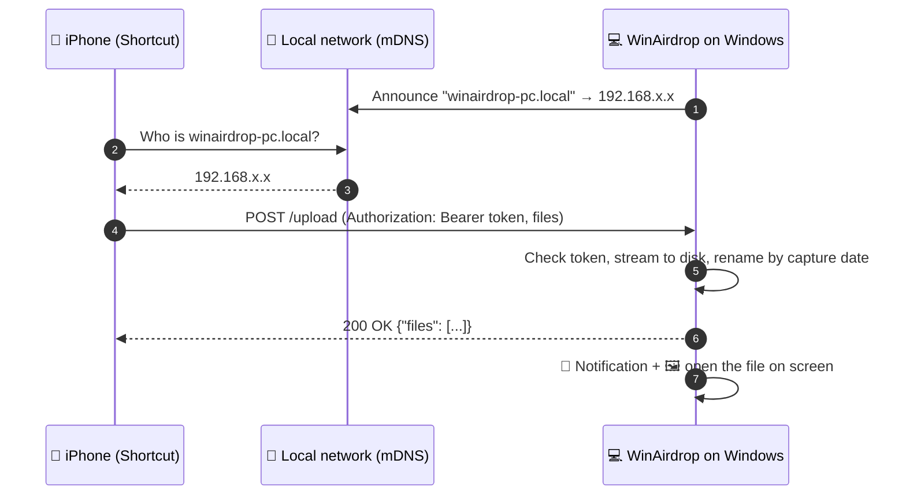

<div align="center">


# WinAirdrop

**AirDrop-style sharing from your iPhone and iPad to Windows.**<br>
Tap Share → **WinAirdrop** and the photo pops up on your PC. No cables, no cloud, no app to install on the phone.<br>
<sub>Created by <a href="https://github.com/josedag31">@josedag31</a></sub>

[](https://github.com/josedag31/WinAirdrop/releases/latest)
[](https://github.com/josedag31/WinAirdrop/releases)
[](https://github.com/josedag31/WinAirdrop/actions/workflows/ci.yml)
[](LICENSE)


[**Download**](https://github.com/josedag31/WinAirdrop/releases/latest) ·
[Quick start](#-quick-start) ·
[How it works](#-how-it-works) ·
[FAQ](#-faq) ·
[Troubleshooting](#-troubleshooting)

</div>

---

## ✨ Features

- 📤 **Native Share Sheet**: share from Photos, Files, Safari, WhatsApp or any app with a Share button.
- 🖼️ **Pops up on screen, like AirDrop on a Mac**: the photo, video or PDF opens as soon as it arrives.
- 📁 **Any file type**: photos, videos, PDFs, ZIPs, documents. One file or many at once.
- 📶 **Works without Wi-Fi**: connect your laptop to your iPhone's **Personal Hotspot** and it still works.
- 🔎 **Finds your PC automatically** over Bonjour/mDNS (`your-pc.local`). IP changes don't matter.
- 🗓️ **Smart file names**: photos and videos are saved with their **capture date**, like `Photo 2026-09-19 21.13.20.jpg`, instead of `IMG_5107.jpeg`.
- 🔔 **Tray icon and notifications**: a WinAirdrop icon next to the clock shows it's running, opens the settings or the folder, and tells you when files arrive.
- ⚙️ **Point-and-click settings**: save folder, behaviour, startup, firewall and network checks, all from a settings page. No config files needed.
- 🔒 **Private by design**: files never leave your local network. Every upload needs a secret token, received programs are never run, and WinAirdrop only accepts connections on private networks.
- 📱 **iPhone and iPad**: one Shortcut, synced through iCloud.
- 🌍 **English and Spanish**: the installer asks for your language; the settings page, the Shortcut instructions (with the exact iOS names) and the file names follow it.
- 🪶 **Lightweight**: one small background process with no window, no account and no telemetry.

## 📑 Table of contents

- [Quick start](#-quick-start)
- [Installation](#-installation)
- [Set up the iPhone Shortcut](#-set-up-the-iphone-shortcut)
- [Usage](#-usage)
- [Settings](#%EF%B8%8F-settings)
- [Using it without Wi-Fi (Personal Hotspot)](#-using-it-without-wi-fi-personal-hotspot)
- [How it works](#-how-it-works)
- [Security](#-security)
- [Troubleshooting](#-troubleshooting)
- [FAQ](#-faq)
- [Comparison](#-comparison)
- [Building from source](#%EF%B8%8F-building-from-source)
- [API](#-api)
- [Roadmap](#%EF%B8%8F-roadmap)
- [Code signing policy](#-code-signing-policy)
- [Contributing](#-contributing)
- [License](#-license)

## 🚀 Quick start

1. **[Download the installer](https://github.com/josedag31/WinAirdrop/releases/latest)** in your language (`…-English.msi` or `…-Espanol.msi`) and double-click it.
2. WinAirdrop installs in seconds and opens its settings page. Click **Allow WinAirdrop** (firewall).
3. Under **Connect your iPhone**, scan the two QR codes with your iPhone camera: **Install the Shortcut**, then **Pair it with this PC** (the first time you share something).

That's it. Share something from your iPhone → **WinAirdrop** → it pops up on your PC. 🎉

## 📦 Installation

### Requirements

| | |
|---|---|
| **PC** | Windows 10 or 11 |
| **Phone** | iPhone or iPad with the **Shortcuts** app (built into iOS / iPadOS) |
| **Network** | Both devices on the same network: home Wi-Fi, or the PC on the iPhone's Personal Hotspot |

### Installer (recommended)

1. From [Releases](https://github.com/josedag31/WinAirdrop/releases/latest), download the installer in your language:
   - 🇬🇧 `WinAirdrop-vX.Y.Z-English.msi`
   - 🇪🇸 `WinAirdrop-vX.Y.Z-Espanol.msi`

   See the [code signing policy](#-code-signing-policy).
2. **Double-click it.** There are no questions: it installs **for your user only** in a few seconds, without administrator rights, and is set to start with Windows (you can turn that off in the settings).
3. WinAirdrop starts, its icon appears next to the clock, and its **settings page opens** in your browser.
4. On that page, click **Allow WinAirdrop** to let it through the firewall (one Windows permission prompt, private networks only).

To open the settings later, **open WinAirdrop again from the Start menu**. If it's already running, that brings up the settings page.

> [!NOTE]
> WinAirdrop is new and not code-signed yet, so Windows **SmartScreen** may show a blue/red “Windows protected your PC” screen: click **More info → Run anyway**. Some antivirus programs may also ask about it the first time. See [Windows or my antivirus warns about WinAirdrop](#windows-or-my-antivirus-warns-about-winairdrop).

<details>
<summary><b>Portable version (no installation)</b></summary>

Download `WinAirdrop-vX.Y.Z-portable.zip`, unzip it to a permanent folder and run `WinAirdrop.exe`. The portable version keeps its settings in a `.env` file inside that folder. Use the settings page to allow it through the firewall and to start it with Windows.
</details>

<details>
<summary><b>Verify your download (optional)</b></summary>

Each release includes `SHA256SUMS.txt`. Compare it with:

```powershell
(Get-FileHash .\WinAirdrop-v1.0.1-English.msi -Algorithm SHA256).Hash
```
</details>

<details>
<summary><b>Uninstall</b></summary>

*Settings → Apps → Installed apps → WinAirdrop → Uninstall*. This also removes the firewall rules and the startup entry.
Your received files and your settings (`%APPDATA%\WinAirdrop`) are kept. Delete that folder if you want a clean slate.
</details>

## 📲 Set up the iPhone Shortcut

**The easy way (two scans, no typing):** open the settings page and, under **Connect your iPhone**:

1. Scan **Install the Shortcut** with the iPhone camera → **Add Shortcut**. (Or open [the Shortcut on iCloud](https://www.icloud.com/shortcuts/aaeb86cd9401452bab052989157bb89d) on your iPhone.)
2. Share any photo → **WinAirdrop**. The first time, a code scanner opens: scan **Pair it with this PC**. From then on it sends straight away.

The shared Shortcut contains no address or token: it saves the pairing in `Shortcuts/WinAirdrop.txt` on your iPhone. If you reset the token on the PC, it tells you and asks you to scan the pairing code again.

<details>
<summary><b>Or build the Shortcut yourself</b></summary>


Open the settings page (**<http://localhost:8770/setup>**, or open WinAirdrop from the Start menu). Under **Connect your iPhone** you'll find your personal URL and token, a QR code for the token, and these steps.

<details open>
<summary><b>Step-by-step instructions</b></summary>

1. Open **Shortcuts** → tap **+** → name it **WinAirdrop**.
2. Tap **ⓘ** → enable **Show in Share Sheet**. Leave the accepted types as **Any**.
3. In the first block, set **If there's no input** → **Ask For** → **Files**.
4. Add **Repeat with Each** → item in **Shortcut Input**.
5. Inside the loop, add **Get Contents of URL**:
   - **URL**: type `http://<your-pc-name>.local:8770/upload` by hand (the settings page shows the exact value).
   - Tap **›** → **Method**: `POST`
   - **Headers** → add `Authorization` = `Bearer <your-token>`. Scan the QR to copy it.
   - **Request Body**: `Form` → add a **File** field with key `file` and value **Repeat Item**.
6. After **End Repeat**, add **Show Notification** → `Sent to PC ✅`.
7. The first time you run it, iOS asks to **find devices on your local network**. Tap **Allow**.

</details>

</details>

> [!TIP]
> With **iCloud sync** for Shortcuts turned on, the Shortcut also appears on your iPad.

> [!WARNING]
> Don't put a variable in the URL field. If you see *"Couldn't convert Rich Text to URL"*, the **Repeat Item** ended up in the URL instead of the form body.

## 👆 Usage

On your iPhone or iPad: open any photo, video or file → **Share** → **WinAirdrop**.

- **It pops up on your PC**: a photo, video, audio file, PDF or text file opens in its default app, just like AirDrop on a Mac. Send several at once and File Explorer opens with them selected.
- Files are saved to **`Pictures\WinAirdrop`** by default (you can change this in the settings).
- Photos and videos are renamed with their capture date: `Photo 2026-09-19 21.13.20.jpg`, `Video 2026-09-19 21.15.02.mov`. Other files keep their name. Nothing is ever overwritten: duplicates become `name (1).ext`.
- If the PC is off, asleep or on another network, the Shortcut shows a connection error and nothing is sent.

## ⚙️ Settings

Everything can be changed from the **settings page**: open WinAirdrop from the Start menu, or go to <http://localhost:8770/setup>.

| Setting | Default | What it does |
|---|---|---|
| **Save files to** | `Pictures\WinAirdrop` | Any folder. **Browse…** opens the Windows folder picker |
| **When files arrive** | Open them on screen | *Open* (like a Mac) · *Show in File Explorer* · *Just save them* |
| **Smart names** | On | Rename photos and videos by capture date |
| **Notifications** | On | Windows notification when files arrive |
| **Start with Windows** | On (installer) | Run in the background when you sign in |
| **Language** | The installer you downloaded | English or Spanish: page, notifications, file names |
| **Network name** | `winairdrop-<computer>` | The iPhone finds the PC as `<name>.local` |
| **Port** | `8770` | Only change it if another program uses 8770 |

The settings page also checks the **firewall** and your **networks**, and fixes them with one click.

<details>
<summary><b>Advanced: the <code>.env</code> file</b></summary>

The settings are stored in a `.env` file:

- **Installed**: `%APPDATA%\WinAirdrop\.env`
- **Portable or from source**: `.env` next to the program

You can edit it by hand and restart WinAirdrop. Every option is documented in [`.env.example`](.env.example):

| Variable | Default | |
|---|---|---|
| `WINAIRDROP_LANGUAGE` | installer / Windows | `en` · `es` |
| `WINAIRDROP_FOLDER` | `Pictures\WinAirdrop` | Absolute path, `%VARIABLES%` allowed |
| `WINAIRDROP_ON_RECEIVE` | `open` | `open` · `reveal` · `none` |
| `WINAIRDROP_RENAME_BY_DATE` | `1` | `0` keeps iOS names |
| `WINAIRDROP_NOTIFICATIONS` | `1` | `0` turns notifications off |
| `WINAIRDROP_NAME` | `winairdrop-<computer>` | Lowercase letters, digits, hyphens |
| `WINAIRDROP_PORT` | `8770` | 1024–65535 |
| `WINAIRDROP_TOKEN` | random | Generated on first run. **Keep it secret** |

The log (`winairdrop.log`) is stored next to the `.env`.
</details>

## 📶 Using it without Wi-Fi (Personal Hotspot)

On a train, in a café, or anywhere without trusted Wi-Fi:

1. On the iPhone, turn on **Settings → Personal Hotspot**.
2. Connect your laptop to the iPhone's hotspot.
3. **The first time only**: Windows marks phone hotspots as *Public*. Open the WinAirdrop settings and click **Trust this network** next to your hotspot.
4. Share as usual. WinAirdrop notices the network change and announces itself on it within about 10 seconds.

An iPad connected to the same hotspot works too.

## 🧠 How it works



- **Discovery**: WinAirdrop publishes an mDNS (Bonjour) record for `<name>.local` on every real network adapter (Wi-Fi, Ethernet, hotspot) and skips virtual ones (WSL, Hyper-V, Docker, VPNs). It checks for network changes every 10 seconds and announces itself again.
- **Transfer**: the iOS Shortcut sends each file as `multipart/form-data`. The server streams it to a `.partial` file and renames it when complete, so a cancelled transfer never leaves a broken file behind.
- **Naming**: the capture date comes from the photo's EXIF `DateTimeOriginal`, or from the `mvhd` atom of MOV/MP4 videos.

### Why isn't this *real* AirDrop?

AirDrop runs over **AWDL** (Apple Wireless Direct Link), a proprietary peer-to-peer Wi-Fi protocol. Speaking AWDL from a non-Apple device needs a Wi-Fi card in **monitor mode with packet injection**. On Linux that is possible with some cards ([OpenDrop](https://github.com/seemoo-lab/opendrop) and [OWL](https://github.com/seemoo-lab/owl) from TU Darmstadt's SEEMOO lab). **No Windows Wi-Fi driver supports it.**

So WinAirdrop takes the practical route: the same Share Sheet experience over your normal network. The trade-off is that both devices must be on the same network. Your iPhone's hotspot counts.

## 🔒 Security

| Topic | How WinAirdrop handles it |
|---|---|
| **Authentication** | Every upload needs `Authorization: Bearer <token>`. The token is random (192 bits), generated on your PC, stored only in your `.env`, and compared in constant time. |
| **Received programs** | Never run. Only photos, videos, audio, PDFs and text files are opened automatically. Anything else (`.exe`, `.bat`, `.lnk`, Office files…) is only shown in File Explorer. |
| **Disguised file names** | Invisible Unicode control characters (like the right-to-left override used to fake `photo‮gpj.exe` → "photoexe.jpg") are removed. |
| **Mark of the Web** | Received files are tagged like browser downloads, so Windows SmartScreen and Office Protected View still protect you if you open them yourself. |
| **Path traversal** | File names are sanitized: no paths (`../`), no forbidden characters, no reserved Windows names (`CON`, `NUL`…). Nothing is ever overwritten. |
| **Settings page** | Only answers the browser on the PC itself, checks the `Host` header (blocks DNS-rebinding attacks), and requires a per-session anti-CSRF token for every change. It can't be framed and isn't cached. |
| **Network exposure** | The firewall rules only cover **Private** networks. On public Wi-Fi, WinAirdrop is unreachable. |
| **Encryption** | ⚠️ Traffic is **plain HTTP** inside your local network. Use WinAirdrop on networks you trust (home, your own hotspot). |
| **Privacy** | No telemetry, no accounts, no internet connections. |

**Token leaked?** Settings page → **Reset token**, then paste the new one into the Shortcut.

To report a vulnerability, see [SECURITY.md](SECURITY.md).

## 🩺 Troubleshooting

| Symptom | Likely cause | Fix |
|---|---|---|
| *"Could not connect to the server"* | PC asleep or off, or on another network | Wake the PC and check both devices are on the same network |
| Works at home, fails on the hotspot | Windows marked the hotspot as **Public** | Settings page → **Trust this network** |
| Nothing ever connects | Firewall | Settings page → **Allow WinAirdrop** |
| `401` / *invalid token* | Wrong or old token in the Shortcut | Copy it again from the settings page |
| *"Couldn't convert Rich Text to URL"* | A variable in the URL field | Type the URL by hand, put **Repeat Item** in the form body |
| Fails on campus or hotel Wi-Fi | **Client isolation**: devices can't see each other | Use your iPhone's hotspot instead |
| The file doesn't open on screen | It isn't a photo, video, audio, PDF or text file | By design: other types are shown in File Explorer |
| “Windows protected your PC” or an antivirus warning | WinAirdrop is new and not code-signed yet | See [the FAQ](#windows-or-my-antivirus-warns-about-winairdrop) |
| The settings page says the site can't be reached | WinAirdrop isn't running | Open **WinAirdrop** from the Start menu. Look for its icon next to the clock |

Still stuck? Check `winairdrop.log` (in `%APPDATA%\WinAirdrop`) and [open an issue](https://github.com/josedag31/WinAirdrop/issues/new/choose).

## ❓ FAQ

<details>
<summary><b>Do I need to install an app on my iPhone?</b></summary>

No. It uses **Shortcuts**, which comes with iOS. You build the Shortcut once by following the steps.
</details>

<details>
<summary><b>Does it need internet?</b></summary>

No. Everything stays on your local network. With the Personal Hotspot it works even with mobile data off: the hotspot only connects the two devices.
</details>

<details>
<summary><b>Can several iPhones send to the same PC?</b></summary>

Yes. Any device on the same network with the Shortcut and the token can send. Only share the token with people you trust.
</details>

<details>
<summary><b>Can I send from the PC to the iPhone?</b></summary>

Not yet. It's on the [roadmap](#%EF%B8%8F-roadmap).
</details>

<details>
<summary><b>Does it work on Android?</b></summary>

The PC side works with anything that can send an HTTP POST, so an Android automation app (HTTP Shortcuts, Tasker…) can use the [API](#-api). The documented setup targets iOS.
</details>

<details>
<summary><b>Why can't you give me a ready-made Shortcut file?</b></summary>

Since iOS 15, `.shortcut` files must be signed, and only macOS can sign them. Your URL and token are also personal. Building it yourself takes about 3 minutes.
</details>

<details id="windows-or-my-antivirus-warns-about-winairdrop">
<summary><b>Windows or my antivirus warns about WinAirdrop</b></summary>

Windows SmartScreen and antivirus programs are wary of any program that is **new** (few people have downloaded it yet) and **not code-signed** (a paid digital signature that identifies the publisher). WinAirdrop is both, for now. It's not a virus detection.

- **SmartScreen**: click **More info → Run anyway**.
- **Antivirus**: allow it if it asks. WinAirdrop is built to look as little like malware as possible: no scripts, no PowerShell, a normal program folder instead of a self-extracting file, and admin rights only for the firewall, through the standard Windows prompt.
- Don't trust a random download: get WinAirdrop only from [this repository's Releases](https://github.com/josedag31/WinAirdrop/releases) and check it against `SHA256SUMS.txt`. The code is all here, and every release is built by GitHub Actions from it.

Code signing is on the [roadmap](#%EF%B8%8F-roadmap); these warnings disappear once releases are signed and the app gains reputation.
</details>

<details>
<summary><b>Will my HEIC photos arrive as HEIC?</b></summary>

When you share from the Photos app, iOS usually converts them to **JPG** and keeps the EXIF data, including the capture date. That's iOS's choice, not WinAirdrop's.
</details>

## 📊 Comparison

| | WinAirdrop | AirDrop | Cloud sync (iCloud, Google Photos…) | Cable / email to yourself |
|---|:---:|:---:|:---:|:---:|
| iPhone → Windows | ✅ | ❌ (Apple devices only) | ✅ | ✅ |
| From the Share Sheet | ✅ | ✅ | ⚠️ depends on the app | ❌ |
| Opens on screen when it arrives | ✅ | ✅ | ❌ | ❌ |
| No internet needed | ✅ | ✅ | ❌ | ✅ (cable) |
| No account | ✅ | ✅ | ❌ | ❌ (email) |
| Any file type | ✅ | ✅ | ⚠️ mostly photos | ✅ |
| Files stay on your devices | ✅ | ✅ | ❌ | ⚠️ (email) |
| Free & open source | ✅ | — | ❌ | — |

## 🛠️ Building from source

Requires **Python 3.13+**.

```powershell
git clone https://github.com/josedag31/WinAirdrop.git
cd WinAirdrop
python -m venv .venv
.\.venv\Scripts\python.exe -m pip install -r requirements.txt
.\start.ps1
```

Run the tests and build the executable:

```powershell
.\.venv\Scripts\python.exe -m pip install -r requirements-dev.txt
.\.venv\Scripts\python.exe -m pytest
.\.venv\Scripts\pyinstaller.exe --onefile --noconsole --name WinAirdrop --icon assets/icon.ico --add-data "setup.html;." --add-data "locales;locales" --collect-submodules zeroconf winairdrop.py
```

The installers are Windows Installer (MSI) packages built with [WiX Toolset v5](https://wixtoolset.org) from [`installer/WinAirdrop.wxs`](installer/WinAirdrop.wxs), one per language. Releases are built and published by GitHub Actions when a `vX.Y.Z` tag is pushed ([release.yml](.github/workflows/release.yml)).

<details>
<summary><b>Project structure</b></summary>

```
WinAirdrop/
├── winairdrop.py          # the server: HTTP, mDNS, settings API, files, notifications
├── setup.html             # the settings page (/setup)
├── locales/               # English and Spanish texts
├── installer/             # WiX (MSI) installer and exe version info
├── start.ps1              # start from source in the background
├── .env.example           # every setting, documented
├── tests/                 # pytest suite (no network needed)
├── assets/                # logo and icon
└── .github/workflows/     # CI and release pipelines
```
</details>

## 🔌 API

WinAirdrop is a tiny HTTP server, so anything can send to it: Android, scripts, other computers.

| Method | Path | Description |
|---|---|---|
| `POST` | `/upload` | `Authorization: Bearer <token>`. Either `multipart/form-data` with one or more `file` fields, or a raw body with an `X-Filename` header. Returns `{"ok": true, "files": [...]}` |
| `GET` | `/ping` | Health check: `{"ok": true, "app": "WinAirdrop", "name": "...", "version": "..."}` |

```bash
curl -H "Authorization: Bearer $TOKEN" -F file=@photo.jpg -F file=@notes.pdf http://winairdrop-pc.local:8770/upload
```

`/setup` and `/api/*` belong to the settings page and only work from the PC itself.

## 🗺️ Roadmap

- [ ] Code-signed releases (no more SmartScreen warnings)
- [ ] PC → iPhone transfers
- [ ] Optional HTTPS with a locally trusted certificate
- [ ] Transfer progress for large files

Ideas welcome: [open a feature request](https://github.com/josedag31/WinAirdrop/issues/new/choose).

## 🔏 Code signing policy

Releases are **not code-signed yet**, which is why Windows SmartScreen and some antivirus programs warn about them. Code signing is planned; when it's in place, this section will name the certificate and its provider.

WinAirdrop releases are built automatically by [GitHub Actions](.github/workflows/release.yml) from the source code in this repository. Nothing is built or uploaded by hand.

- **Committers and reviewers:** [@josedag31](https://github.com/josedag31). Changes proposed by anyone else (pull requests) are reviewed by a committer before merging.
- **Approvers** (who decide whether a release is signed): [@josedag31](https://github.com/josedag31).
- Every maintainer uses multi-factor authentication on GitHub.

**Privacy policy:** this program will not transfer any information to other networked systems unless specifically requested by the user or the person installing or operating it. WinAirdrop only receives files that you send it from your own devices on your local network, and makes no internet connections.

## 🤝 Contributing

Contributions are welcome. Read [CONTRIBUTING.md](CONTRIBUTING.md), open an issue for discussion, or send a pull request.

If WinAirdrop saves you some cables, consider giving it a ⭐. It helps other people find it.

## 🙏 Acknowledgements

- [SEEMOO Lab (TU Darmstadt)](https://github.com/seemoo-lab): their [OpenDrop](https://github.com/seemoo-lab/opendrop) and [OWL](https://github.com/seemoo-lab/owl) research documented how AirDrop works.
- [aiohttp](https://github.com/aio-libs/aiohttp), [python-zeroconf](https://github.com/python-zeroconf/python-zeroconf), [Pillow](https://github.com/python-pillow/Pillow), [PyInstaller](https://github.com/pyinstaller/pyinstaller) and [WiX Toolset](https://wixtoolset.org).

## 📄 License

[MIT](LICENSE) © 2026 [josedag31](https://github.com/josedag31). Free to use, modify and share.

<div align="center">

Made with ❤️ by <a href="https://github.com/josedag31"><b>@josedag31</b></a>

</div>

<sub>WinAirdrop is an independent project, not affiliated with, endorsed by, or sponsored by Apple Inc. AirDrop, iPhone, iPad and iOS are trademarks of Apple Inc., registered in the U.S. and other countries.</sub>
